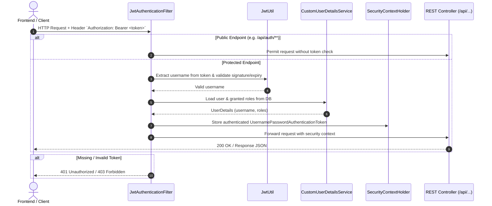

# Spring Security & JWT Implementation Guide

This document explains the security architecture implemented in the **Intelligent Address Management System**: what components were built, why they were chosen, and how they interact.

---

## 1. Architecture & Request Flow

Every incoming HTTP request goes through a custom filter chain before reaching your Controllers.



---

## 2. Components Created & Why

### 1. `Role.java` (Enum)
* **Location:** `com.nithin.addressmanagement.entity.Role`
* **Purpose:** Defines application roles: `ROLE_USER` and `ROLE_ADMIN`.
* **Why:** In Spring Security, authority names standardly use the `ROLE_` prefix. This enables Role-Based Access Control (RBAC).

---

### 2. `User.java` (JPA Entity) & `UserRepository.java`
* **Location:** `com.nithin.addressmanagement.entity.User`, `repository.UserRepository`
* **Purpose:** Stores user credentials (`id`, `username`, `email`, `password`, `role`, `createdAt`) in the MySQL `users` table.
* **Why:** Decouples customer address records from system authentication accounts. Allows multiple administrators or team members to log in and manage customer addresses.

---

### 3. `JwtUtil.java` (Token Utility)
* **Location:** `com.nithin.addressmanagement.security.JwtUtil`
* **Purpose:** Handles JWT lifecycle:
  * Generates signed JWT tokens with claims (username, role, issued date, expiry).
  * Validates token cryptographic signature and expiration.
  * Extracts subject (username) from incoming tokens.
* **Why:** JWT enables **stateless authentication**. The server does not store user session states in memory, allowing easy horizontal scaling and seamless REST API consumption.

---

### 4. `CustomUserDetailsService.java`
* **Location:** `com.nithin.addressmanagement.security.CustomUserDetailsService`
* **Purpose:** Implements Spring Security's `UserDetailsService` interface.
* **Why:** Bridges our custom MySQL `User` entity with Spring Security's internal `UserDetails` model, converting user roles into `GrantedAuthority` collections.

---

### 5. `JwtAuthenticationFilter.java`
* **Location:** `com.nithin.addressmanagement.security.JwtAuthenticationFilter`
* **Purpose:** Extends `OncePerRequestFilter` to intercept all incoming requests once.
* **How it works:**
  1. Inspects the `Authorization` header for `Bearer <token>`.
  2. Extracts and verifies the token.
  3. Populates `SecurityContextHolder` with an authenticated `UsernamePasswordAuthenticationToken`.
* **Why:** Ensures downstream controllers know who the authenticated user is and what roles they possess.

---

### 6. `SecurityConfig.java` (Security Configuration)
* **Location:** `com.nithin.addressmanagement.security.SecurityConfig`
* **Purpose:** Central configuration bean defining:
  * **CSRF Disabled:** Since we use token-based REST APIs rather than session cookies.
  * **Stateless Sessions:** (`SessionCreationPolicy.STATELESS`) - No HTTP sessions created on server.
  * **CORS Policy:** Allows the frontend origin to perform cross-origin requests.
  * **Endpoint Rules:**
    * `/api/auth/**` -> Public (`permitAll()`).
    * `DELETE /api/customers/**` -> Restricted to `ROLE_ADMIN`.
    * Any other `/api/**` request -> Requires authentication.
  * **BCryptPasswordEncoder:** Secures passwords using salted BCrypt hashing.
  * **Filter Placement:** Injects `JwtAuthenticationFilter` before `UsernamePasswordAuthenticationFilter`.

---

### 7. `AuthService.java` & `AuthController.java`
* **Location:** `service.AuthService`, `controller.AuthController`
* **Endpoints:**
  * `POST /api/auth/register` — Validates unique username/email, hashes password with BCrypt, stores the user, and returns a JWT token.
  * `POST /api/auth/login` — Uses Spring's `AuthenticationManager` to verify credentials and returns a JWT token.

---

### 8. `GlobalExceptionHandler.java` (Updated)
* **Purpose:** Catches `BadCredentialsException` (returns HTTP 401 with informative error) and `RuntimeException` (returns HTTP 400 for duplicate registrations).

---

### 9. Frontend Authentication Integration
* **Location:** `frontend/index.html`, `frontend/app.js`, `frontend/style.css`
* **Features:**
  * Login and Register form tabs.
  * Stores JWT token in `localStorage`.
  * Automatically appends `Authorization: Bearer <token>` to all protected API calls.
  * Role badge indicator (`USER` vs `ADMIN`).
  * Shows/hides admin actions (e.g. Delete customer button).
  * Auto-redirects to login when token is missing or expired (HTTP 401/403).

---

## 3. How to Test the Security Flow

### 1. Register a new user:
```bash
curl -X POST http://localhost:8080/api/auth/register \
  -H "Content-Type: application/json" \
  -d '{"username": "testuser", "email": "test@example.com", "password": "password123"}'
```

### 2. Login:
```bash
curl -X POST http://localhost:8080/api/auth/login \
  -H "Content-Type: application/json" \
  -d '{"username": "testuser", "password": "password123"}'
```
*Response contains:*
```json
{
  "token": "eyJhbGciOiJIUzUxMiJ...",
  "username": "testuser",
  "role": "ROLE_USER"
}
```

### 3. Call protected endpoint with token:
```bash
curl -X GET http://localhost:8080/api/customers \
  -H "Authorization: Bearer <YOUR_TOKEN>"
```

### 4. Call without token (Expect 403 Forbidden):
```bash
curl -X GET http://localhost:8080/api/customers
```
